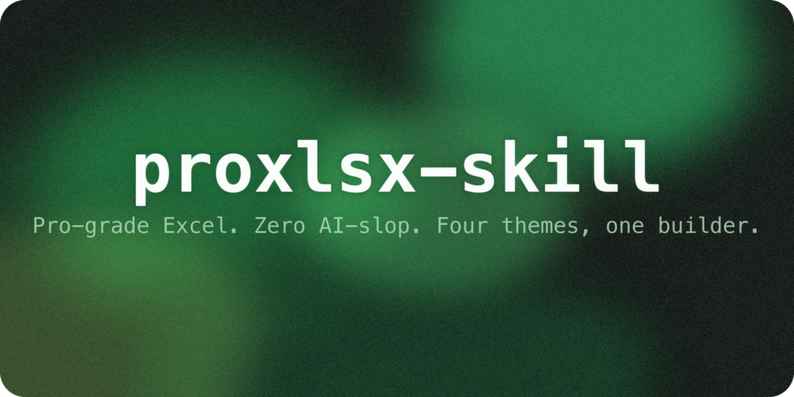
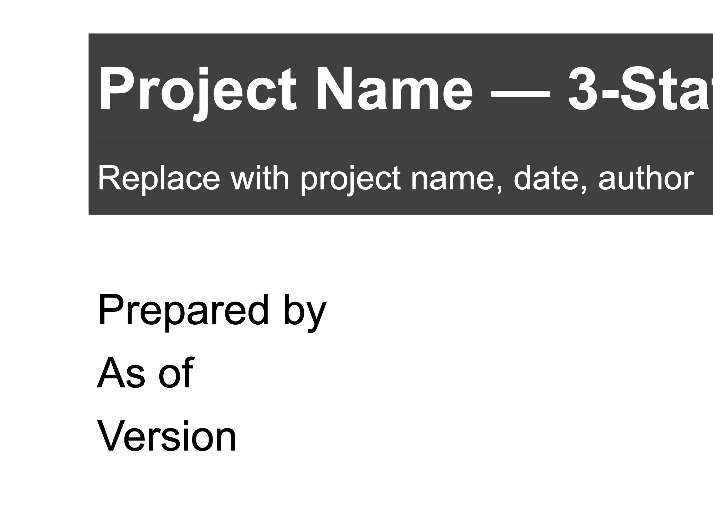
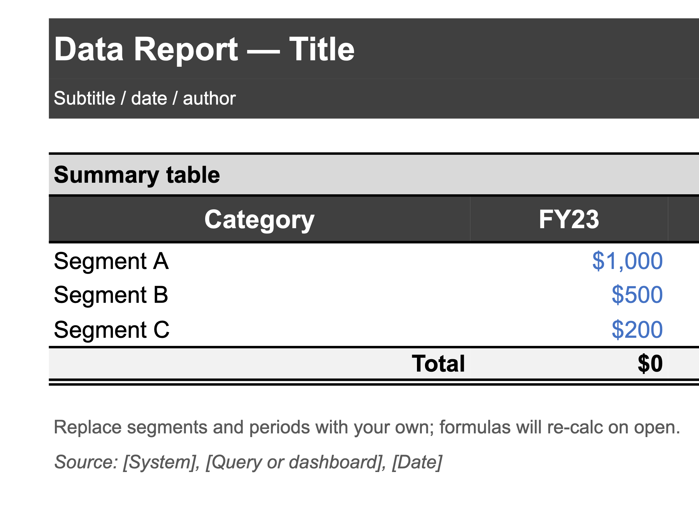
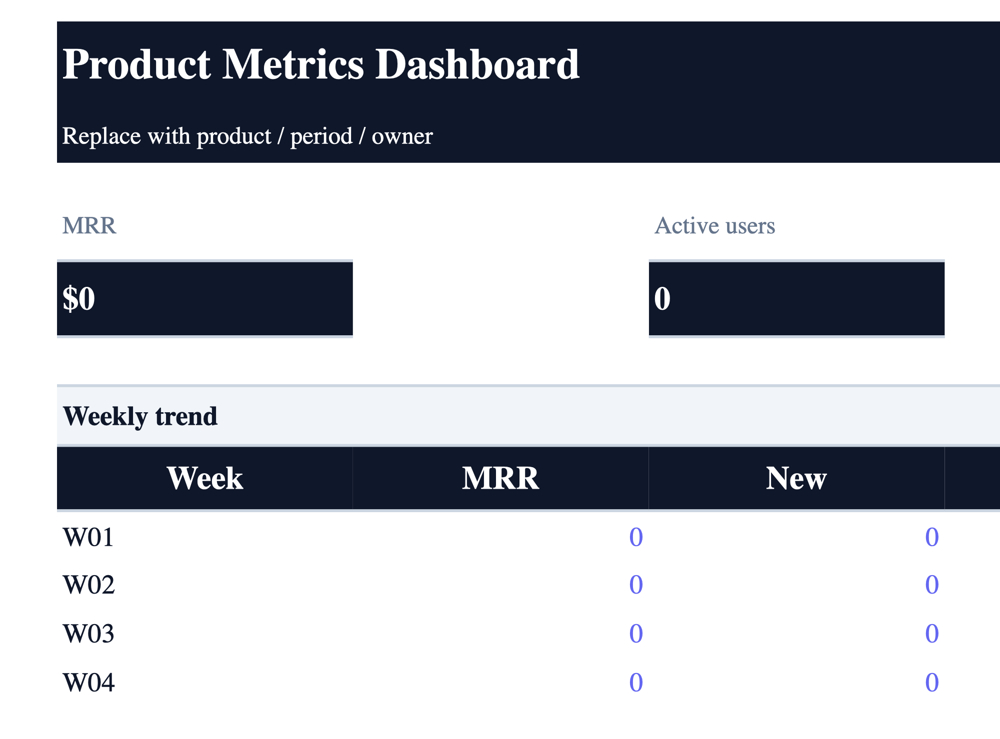
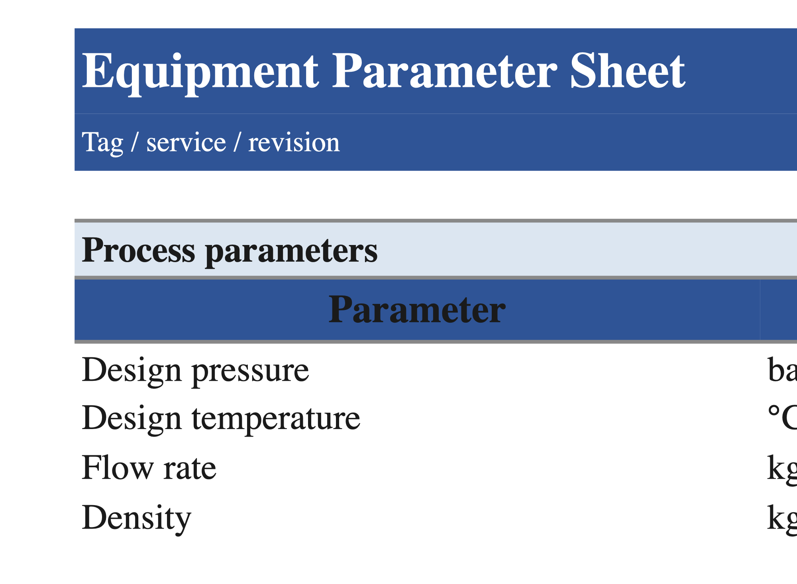

<p align="center"></p>

<h1 align="center">proxlsx-skill</h1>
<p align="center">
  <em>Claude Code를 위한 프로 등급 엑셀 생성 스킬 — 4개 테마, 빌더 API, 그리고 AI-slop을 원천 차단하는 스타일 린터.</em>
</p>
<p align="center">
  <a href="#빠른-시작">빠른 시작</a> · <a href="#테마">테마</a> · <a href="#동작-방식">동작 방식</a> · <a href="./README.md">English</a>
</p>
<p align="center">
  
  
  
  
</p>

---

> [!NOTE]
> **생성된 티가 나지 않는** 엑셀 파일을 만드는 Claude Code 스킬입니다. 4개의 교체 가능한 테마 (IB / 엔지니어링 / 한국 대기업 / SaaS 대시보드), raw openpyxl 실수를 원천 차단하는 빌더 API, 가중 slop-score를 산출하는 스타일 린터, 금지어 방화벽을 제공합니다. 모든 출력은 저장 전에 자동 anti-slop 검사를 통과해야 합니다.

## 샘플 출력

아래의 모든 파일은 `build_xlsx.save_and_validate()`를 통해 생성되었으며 스타일 린터 검사에서 `slop_score = 0`을 기록했습니다. Excel에서 직접 열어 폰트/테두리/숫자 포맷을 확인해 보세요.

<table>
  <tr>
    <td align="center">
      <br />
      <sub><b>재무 모델</b> — <code>ib</code> 테마</sub>
    </td>
    <td align="center">
      <br />
      <sub><b>데이터 리포트</b> — <code>ib</code> 테마</sub>
    </td>
  </tr>
  <tr>
    <td align="center">
      <br />
      <sub><b>SaaS 대시보드</b> — <code>saas</code> 테마</sub>
    </td>
    <td align="center">
      <br />
      <sub><b>엔지니어링 시트</b> — <code>engineering</code> 테마</sub>
    </td>
  </tr>
</table>

## 문제 정의

기본 `openpyxl` 출력은 **2초 안에** LLM이 만들었다는 걸 들키게 됩니다: Calibri 11, 보이는 그리드라인, `Sheet1` 탭명, 포맷 없는 숫자, 무작위 열 너비, 프리즈 페인 없음, 배너 행 없음. 이 스킬은 Macabacus / BIWS / Wall Street Prep의 업계 표준에서 도출한 고정 디자인 시스템으로 이 모든 디폴트를 대체합니다.

## 주요 기능

- **4개 테마 기본 제공** — `ib` (기본값, Macabacus 팔레트), `engineering` (Consolas + SI 단위), `korean_corp` (Pretendard + HD 스타일 팔레트), `saas` (Aptos + 슬레이트/인디고/에메랄드)
- **드리프트를 방지하는 빌더 API** — `new_workbook → write_table → save_and_validate`. raw `Font()` / `PatternFill()` 호출을 원천 차단. 모든 셀이 활성 테마의 `NamedStyle`을 받습니다
- **slop-score 스타일 린터** — `validate_xlsx.py`는 9개 스타일 규칙 (그리드라인 숨김, 기본 탭명 금지, 기본 폰트 오버라이드, 탭 색상, 프리즈 페인, 숫자 포맷 커버리지, A1 비어 있음 금지, 레인보우 채우기 금지, 전략적 테두리)을 검사하고 `recalc.py`를 실행한 뒤 금지어를 스캔합니다. 0–100 가중 점수
- **금지어 방화벽** — `TBD`, `FIXME`, `혁신적인`, `최첨단`, 정량화 없는 `시너지` 등. 한 번이라도 적중하면 검증 즉시 실패
- **4개 스켈레톤 템플릿** — `financial-model`, `data-report`, `dashboard`, `engineering-sheet`. 단일 스크립트로 전부 재생성 가능
- **QA 단계 게이트** — 모든 작업은 완료 선언 전에 QA-1 (테마 적용) → QA-2 (수식 오류 0) → QA-3 (린터 통과) → QA-4 (금지어 없음)을 순차 통과
- **박스 개봉 시 slop_score = 0** — 4개 템플릿 + SaaS 회귀 eval 모두 `slop_score = 0` 통과

## 빠른 시작

### 복사-붙여넣기 설치

> [!TIP]
> 스킬을 지원하는 모든 LLM CLI에서 작동합니다 (Claude Code, Codex, Gemini CLI). 아래 블록을 채팅창에 붙여넣기만 하면 됩니다.

```
xlsx skill을 설치해 줘. 아래 단계대로 실행해:
1. git clone https://github.com/wjgoarxiv/proxlsx-skill.git /tmp/proxlsx-skill
2. mkdir -p ~/.claude/skills/xlsx && cp -r /tmp/proxlsx-skill/SKILL.md /tmp/proxlsx-skill/theme.py /tmp/proxlsx-skill/build_xlsx.py /tmp/proxlsx-skill/validate_xlsx.py /tmp/proxlsx-skill/recalc.py /tmp/proxlsx-skill/FORBIDDEN_TERMS.json /tmp/proxlsx-skill/templates /tmp/proxlsx-skill/references ~/.claude/skills/xlsx/
3. pip install openpyxl pandas
4. 테스트: python ~/.claude/skills/xlsx/theme.py
5. "xlsx 스킬 설치 완료"라고 말해 줘
```

### 수동 설치

```bash
git clone https://github.com/wjgoarxiv/proxlsx-skill.git
cd proxlsx-skill

mkdir -p ~/.claude/skills
ln -s "$(pwd)" ~/.claude/skills/xlsx

pip install openpyxl pandas
# 선택: 수식 재계산을 위해 LibreOffice 설치
# macOS:  brew install --cask libreoffice
# Linux:  apt install libreoffice
```

### 기타 도구

| 도구 | 스킬 경로 | 설치 명령 |
|------|----------|----------|
| **Claude Code** | `~/.claude/skills/xlsx/` | 위 참조 |
| **Codex CLI** | `~/.codex/skills/xlsx/` | `mkdir -p ~/.codex/skills && ln -s "$(pwd)" ~/.codex/skills/xlsx` |
| **Gemini CLI** | `~/.gemini/skills/xlsx/` | `mkdir -p ~/.gemini/skills && ln -s "$(pwd)" ~/.gemini/skills/xlsx` |

## 사용법

### 1. 백지에서 재무 모델 생성

```
SaaS 스타트업용 3년 재무 모델 만들어 줘. 1년차 매출 $500K, 성장률 40%,
COGS 30%, OpEx 연 $200K flat. /tmp/saas.xlsx에 저장.
```

스킬은 `theme='ib'`로 새 워크북을 열고, `write_table()`로 Assumptions + IS/BS/CF 시트를 작성하며, 모든 수식을 `Assumptions!`로 링크한 뒤, `save_and_validate()`를 실행해 slop-score를 리포트합니다.

### 2. 스켈레톤 템플릿 로드

```
financial-model-skeleton 템플릿으로 3-statement 모델 만들어 줘.
ARR $15mm, 성장률 45/35/30/25%, 매출총이익률 72/74/75/76%로 채워 줘.
```

`load_template('financial-model-skeleton', theme='ib')`로 6 시트 스타일이 이미 적용된 워크북을 불러와 지정된 셀만 채웁니다.

### 3. 엔지니어링 파라미터 시트

```
engineering 테마로 열교환기 E-101 파라미터 시트 만들어 줘.
설계 압력 35 bar(g), 설계 온도 150°C, 유량 12000 kg/h. Spec/Actual/Delta 패턴 사용.
```

`theme='engineering'`으로 전환 (Consolas 바디, 세밀한 소수, `C3` 프리즈 페인, `2F5496` 탭 색상).

### 4. SaaS 제품 대시보드

```
saas 테마로 주간 제품 지표 대시보드 (MRR, Active Users, Churn, NPS) 만들어서
/tmp/metrics.xlsx에 저장해 줘.
```

4-card 배너는 `write_kpi_band()`로, 트렌드 표는 `write_table()`로 작성합니다.

## 테마

| 테마 | 본문 폰트 | 팔레트 | 분위기 |
|------|-----------|---------|--------|
| `ib` (기본) | Arial 10 | `#000` 잉크 / `#4472C4` 입력 / `#70AD47` 링크 / `#C00000` 외부 / `#404040` 헤더 | Macabacus / BIWS 애널리스트 자료 |
| `engineering` | Consolas 10 | `#1A1A1A` 잉크 / `#0066CC` 입력 / `#008233` 링크 / `#C8102E` 경고 | EPC 계산 시트, SI 단위 |
| `korean_corp` | Pretendard 10 | `#003087` Discovery Blue / `#00AD1D` Heritage Green | 국내 대기업 결재문서 |
| `saas` | Aptos 10 | `#0F172A` 슬레이트 / `#6366F1` 인디고 / `#10B981` 에메랄드 | Notion / Linear 대시보드 |

각 테마는 13개의 NamedStyle (`{theme}_title`, `{theme}_header`, `{theme}_input`, `{theme}_formula`, `{theme}_link`, `{theme}_external`, `{theme}_subtotal`, `{theme}_total`, `{theme}_note`, `{theme}_source`, `{theme}_label`, `{theme}_section`, `{theme}_subtitle`)을 등록하고, 시트별로 그리드라인 숨김, 프리즈 페인, 탭 색상, 행 높이, 여백, 용지 방향을 설정합니다.

## 동작 방식

```
                    proxlsx-skill pipeline
                    ~~~~~~~~~~~~~~~~~~~~

    [사용자 프롬프트]
          |
          v
 +------------------------+
 | 1. new_workbook(theme) |    theme.py: 13개 named style 등록,
 |                        |    'Normal' 폰트 오버라이드, 기본 열 너비 적용
 +------------------------+
          |
          v
 +------------------------+
 | 2. write_table / bands |    build_xlsx.py: 모든 셀이 named style을,
 |   write_title_banner   |    모든 숫자가 format key를 받음.
 |   write_section_header |    raw Font() / Fill() / Border() 금지
 +------------------------+
          |
          v
 +------------------------+
 | 3. save_and_validate   |    QA-1..QA-4 체이닝:
 |                        |    wb.save → recalc.py → validate_xlsx.py
 +------------------------+
          |
          v
 +------------------------+
 | 4. slop_score <= 10    |    9개 스타일 검사 + 금지어 스캔,
 |    실패 시 RAISE       |    [0, 100] 가중 점수
 +------------------------+
```

## Anti-Slop 철학

린터는 AI가 만들었다는 티가 나는 정확한 지표들을 잡아냅니다:

| ❌ Slop 지표 | ✅ 이 스킬의 처리 방식 |
|---|---|
| 전체 Calibri 11 | `Normal` 폰트를 오버라이드; 모든 셀이 테마의 `NamedStyle`을 사용 |
| 보이는 그리드라인 | 화면/인쇄 모두 숨김 |
| `Sheet1` 탭명 | `new_workbook(first_sheet='Cover')`로 실제 이름 강제 |
| 빈 A1 / 제목 없음 | `write_title_banner()`가 모든 시트의 첫 호출 |
| 포맷 없는 숫자 | `write_table(num_format='currency')`가 테마 포맷 키 적용 |
| 모든 행에 통화 심볼 | `$#,##0;($#,##0);"-"` 포맷은 `$`를 열 최상단에만 표시 |
| 음수를 `-123`으로 | 괄호 표기: 테마 숫자 포맷에서 `(123)` |
| 레인보우 채우기 (10+ 색상) | 워크북당 최대 8개 채우기 색상 (린터 강제) |
| 셀에 `TBD` / `혁신적인` | Hard 금지어 → 즉시 검증 실패 |
| 프리즈 페인 없음 | `apply_freeze()`가 테마 기본값 자동 적용 |

## 요구사항

| 의존성 | 필수 | 용도 |
|--------|------|------|
| Python 3.8+ | 필수 | 런타임 |
| `openpyxl` | 필수 | xlsx 읽기/쓰기 |
| `pandas` | 선택 | 데이터 분석 워크플로우 |
| `LibreOffice` | 선택 | `recalc.py`를 통한 수식 재계산. 없어도 파일은 작동; Excel/LibreOffice에서 파일을 처음 열 때 수식이 평가됨 |
| `Pillow` + `numpy` | 선택 | `generate_cover.py`에서만 사용 |

> [!WARNING]
> `LibreOffice` 없이는 수식은 저장되지만 캐시된 값은 Excel에서 파일을 열기 전까지 비어 있습니다. 서버 사이드에서 캐시 값을 채우고 싶다면 설치해 주세요.

## 저장소 구조

```
proxlsx-skill/
├── SKILL.md                      # 스킬 매니페스트 + 파이프라인 문서
├── theme.py                      # 4개 테마, NamedStyle 등록
├── build_xlsx.py                 # 빌더 API: new_workbook, write_table, ...
├── validate_xlsx.py              # slop_score anti-slop 린터
├── recalc.py                     # LibreOffice 수식 재계산
├── FORBIDDEN_TERMS.json          # slop 금지어 방화벽
├── templates/
│   ├── _build_templates.py       # build_xlsx로 스켈레톤 재생성
│   ├── financial-model-skeleton.xlsx
│   ├── data-report-skeleton.xlsx
│   ├── dashboard-skeleton.xlsx
│   └── engineering-sheet-skeleton.xlsx
├── references/
│   ├── pro-xlsx-design-system.md  # 4개 테마 전체 사양 (읽기용)
│   ├── anti-slop-checklist.md     # 30점 시각 QA 체크리스트
│   ├── number-format-cookbook.md  # 이름이 있는 포맷 문자열 + 예시
│   └── sources.md                 # Macabacus / BIWS / WSP URL
├── evals/
│   └── evals.json                 # 6개 eval (기존 3 + anti-slop 3)
├── assets/                        # README 이미지
└── cover.png                      # 2560x1280 커버
```

## 기여

PR 환영입니다. 디자인 시스템 변경은 `theme.py`에 유지해 주시고 린터가 회귀를 잡도록 하세요.

1. 저장소 포크
2. 피처 브랜치 생성 (`git checkout -b feature/my-feature`)
3. `python validate_xlsx.py templates/*.xlsx` 실행 — 모두 `slop_score <= 10` 통과 필수
4. Pull Request 개설

버그 리포트나 기능 요청은 [이슈를 등록](https://github.com/wjgoarxiv/proxlsx-skill/issues)해 주세요.

## 라이선스

이 프로젝트는 [MIT License](./LICENSE)를 따릅니다.

## 감사의 말

디자인 시스템 값은 [Macabacus 색상 팔레트](https://help.macabacus.com/article/200-color-palettes), [Wall Street Prep](https://www.wallstreetprep.com/knowledge/financial-modeling/), [Breaking Into Wall Street](https://breakingintowallstreet.com/kb/excel/), [Training The Street](https://trainingthestreet.com/fmaamoc-article-2-formatting-a-financial-model/)에서 도출했습니다. 전체 인용은 [`references/sources.md`](./references/sources.md)를 참조하세요.
