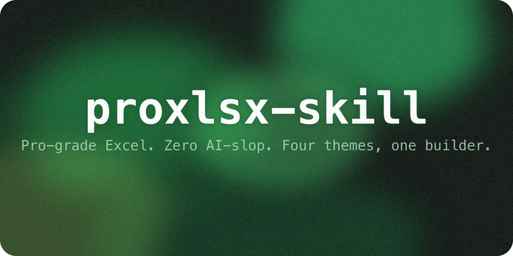
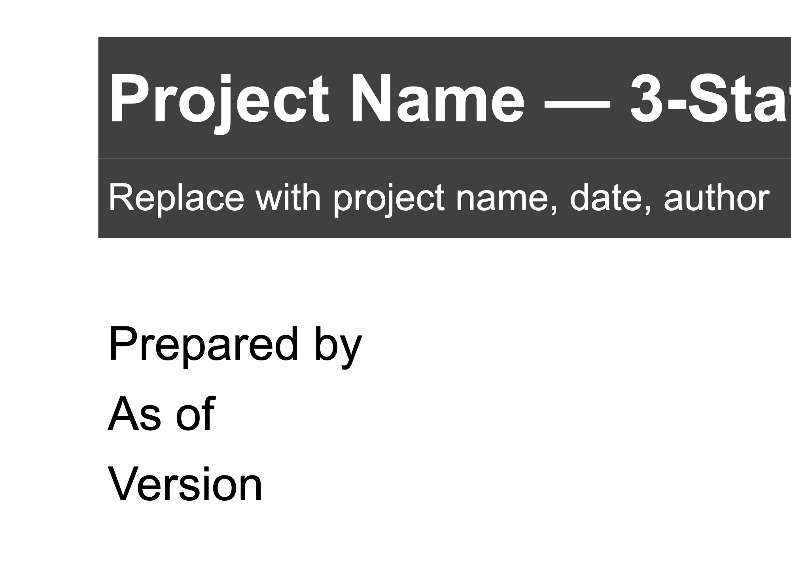
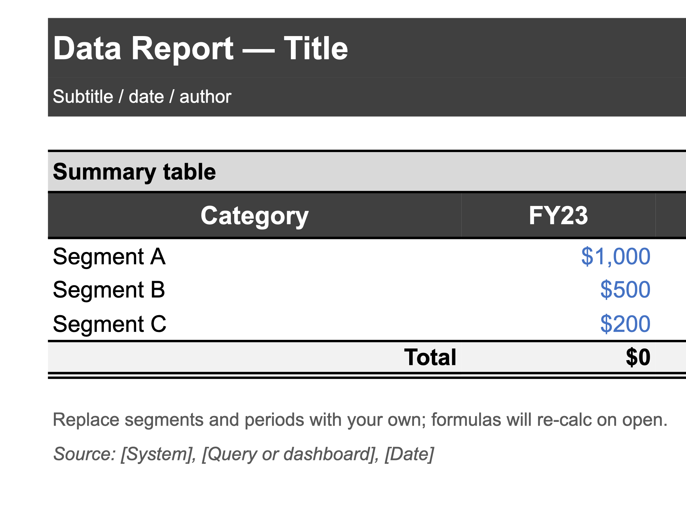
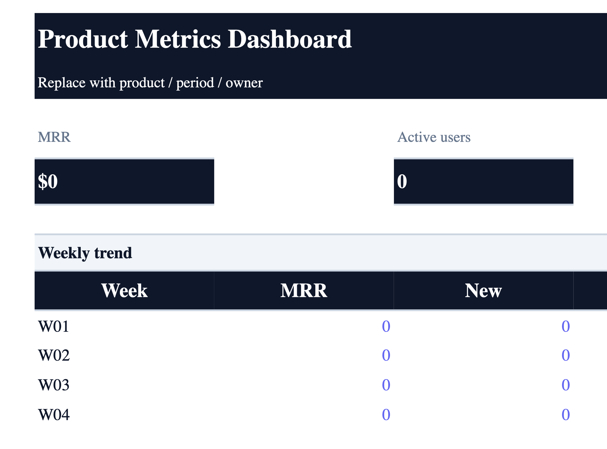
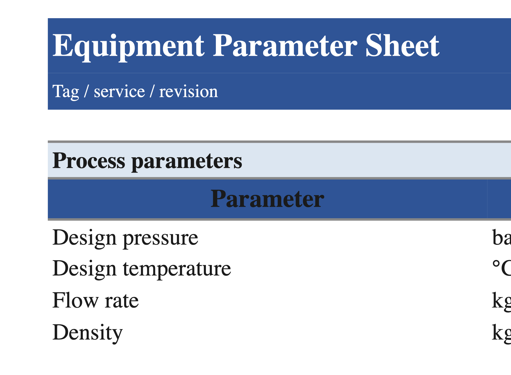

<p align="center"></p>

<h1 align="center">proxlsx-skill</h1>
<p align="center">
  <em>Pro-grade Excel generation for Claude Code -- four themes, a builder API, and a style linter that refuses to ship AI-slop.</em>
</p>
<p align="center">
  <a href="#quick-start">Quick Start</a> · <a href="#themes">Themes</a> · <a href="#how-it-works">How It Works</a> · <a href="./README-Ko-KR.md">한국어</a>
</p>
<p align="center">
  
  
  
  
</p>

---

> [!NOTE]
> A Claude Code skill that generates Excel files that look **designed**, not **generated**. Four swappable themes (IB, engineering, Korean corporate, SaaS dashboard), a builder API that makes raw-openpyxl mistakes impossible, a style linter with a weighted slop-score, and a forbidden-terms firewall. All outputs pass an automated anti-slop check before being saved.

## Sample Output

Every file below was built by the skill through `build_xlsx.save_and_validate()` and passes the style linter with `slop_score = 0`. Open them in Excel to inspect the actual typography / borders / number formats.

<table>
  <tr>
    <td align="center">
      <br />
      <sub><b>Financial model</b> — <code>ib</code> theme</sub>
    </td>
    <td align="center">
      <br />
      <sub><b>Data report</b> — <code>ib</code> theme</sub>
    </td>
  </tr>
  <tr>
    <td align="center">
      <br />
      <sub><b>SaaS dashboard</b> — <code>saas</code> theme</sub>
    </td>
    <td align="center">
      <br />
      <sub><b>Engineering sheet</b> — <code>engineering</code> theme</sub>
    </td>
  </tr>
</table>

## The Problem

Default `openpyxl` output screams "an LLM made this" in under two seconds: Calibri 11, visible gridlines, `Sheet1` tab names, unformatted numbers, random column widths, no freeze panes, no banner row. Analysts can spot it instantly. This skill replaces every one of those defaults with a locked design system derived from Macabacus / BIWS / Wall Street Prep conventions.

## Features

- **Four themes, day one** — `ib` (default, Macabacus palette), `engineering` (Consolas + SI units), `korean_corp` (Pretendard + HD-style palette), `saas` (Aptos + slate/indigo/emerald)
- **Builder API that prevents drift** — `new_workbook → write_table → save_and_validate`. Raw `Font()` / `PatternFill()` calls are discouraged; every cell receives a `NamedStyle` from the active theme
- **Style linter with slop score** — `validate_xlsx.py` checks 9 style rules (hidden gridlines, non-default tab names, default-font override, tab colors set, freeze panes, number-format coverage, non-empty A1, rainbow fills, strategic borders) + runs `recalc.py` + scans for forbidden terms. Weighted 0–100 score
- **Forbidden-terms firewall** — `TBD`, `FIXME`, `revolutionary`, `cutting-edge`, `synergy` without quantification, etc. Any hard hit fails validation immediately
- **Four skeleton templates** — `financial-model`, `data-report`, `dashboard`, `engineering-sheet`. All regenerable from one script
- **QA phase gates** — every task clears QA-1 (theme applied) → QA-2 (zero formula errors) → QA-3 (lint passes) → QA-4 (no forbidden terms) before declaring done
- **Zero slop score out of the box** — all 4 templates + the SaaS regression eval pass with `slop_score = 0`

## Quick Start

### Copy-Paste Install

> [!TIP]
> Works with any LLM CLI that supports skills (Claude Code, Codex, Gemini CLI). Paste the block below into your chat.

```
I want to install the xlsx skill. Do these steps:
1. git clone https://github.com/wjgoarxiv/proxlsx-skill.git /tmp/proxlsx-skill
2. mkdir -p ~/.claude/skills/xlsx && cp -r /tmp/proxlsx-skill/SKILL.md /tmp/proxlsx-skill/theme.py /tmp/proxlsx-skill/build_xlsx.py /tmp/proxlsx-skill/validate_xlsx.py /tmp/proxlsx-skill/recalc.py /tmp/proxlsx-skill/FORBIDDEN_TERMS.json /tmp/proxlsx-skill/templates /tmp/proxlsx-skill/references ~/.claude/skills/xlsx/
3. pip install openpyxl pandas
4. Test: python ~/.claude/skills/xlsx/theme.py
5. Say "xlsx skill installed successfully"
```

### Manual Install

```bash
git clone https://github.com/wjgoarxiv/proxlsx-skill.git
cd proxlsx-skill

mkdir -p ~/.claude/skills
ln -s "$(pwd)" ~/.claude/skills/xlsx

pip install openpyxl pandas
# Optional: install LibreOffice for formula recalculation
# macOS:  brew install --cask libreoffice
# Linux:  apt install libreoffice
```

### Other Tools

| Tool | Skills Path | Install Command |
|------|-------------|-----------------|
| **Claude Code** | `~/.claude/skills/xlsx/` | See above |
| **Codex CLI** | `~/.codex/skills/xlsx/` | `mkdir -p ~/.codex/skills && ln -s "$(pwd)" ~/.codex/skills/xlsx` |
| **Gemini CLI** | `~/.gemini/skills/xlsx/` | `mkdir -p ~/.gemini/skills && ln -s "$(pwd)" ~/.gemini/skills/xlsx` |

## Usage

### 1. Build a financial model from scratch

```
Create a 3-year financial model for a SaaS startup. Year 1: $500K revenue,
40% growth, COGS 30%, OpEx $200K flat. Save to /tmp/saas.xlsx
```

The skill opens a new workbook with `theme='ib'`, writes Assumptions + IS/BS/CF sheets via `write_table()`, links every formula to `Assumptions!`, runs `save_and_validate()`, and reports the slop score.

### 2. Load a skeleton template

```
Build a 3-statement model starting from the financial-model-skeleton template.
Fill in ARR=$15mm, growth 45/35/30/25%, gross margin 72/74/75/76%.
```

Uses `load_template('financial-model-skeleton', theme='ib')` to start from a pre-styled 6-sheet workbook, then fills only the intended cells.

### 3. Engineering parameter sheet

```
Create a parameter sheet for heat exchanger E-101 using the engineering theme.
Include Design pressure 35 bar(g), Design temperature 150°C, Flow rate 12000 kg/h
with a Spec/Actual/Delta pattern.
```

Switches to `theme='engineering'` (Consolas body, tighter decimals, `C3` freeze pane, `2F5496` tab color).

### 4. SaaS product dashboard

```
Build a weekly product metrics dashboard (MRR, Active Users, Churn, NPS)
using the saas theme and save to /tmp/metrics.xlsx
```

Uses `write_kpi_band()` for the 4-card banner and `write_table()` for the trend.

## Themes

| Theme | Body Font | Palette | Feel |
|-------|-----------|---------|------|
| `ib` (default) | Arial 10 | `#000` ink / `#4472C4` input / `#70AD47` link / `#C00000` external / `#404040` header | Macabacus / BIWS analyst exhibit |
| `engineering` | Consolas 10 | `#1A1A1A` ink / `#0066CC` input / `#008233` link / `#C8102E` warn | EPC calculation sheet, SI units |
| `korean_corp` | Pretendard 10 | `#003087` Discovery Blue / `#00AD1D` Heritage Green | 국내 대기업 결재문서 |
| `saas` | Aptos 10 | `#0F172A` slate ink / `#6366F1` indigo / `#10B981` emerald | Notion / Linear dashboard export |

Each theme registers 13 NamedStyles (`{theme}_title`, `{theme}_header`, `{theme}_input`, `{theme}_formula`, `{theme}_link`, `{theme}_external`, `{theme}_subtotal`, `{theme}_total`, `{theme}_note`, `{theme}_source`, `{theme}_label`, `{theme}_section`, `{theme}_subtitle`) and sets gridlines off, freeze panes, tab color, row heights, margins, and orientation per sheet.

## How It Works

```
                    proxlsx-skill pipeline
                    ~~~~~~~~~~~~~~~~~~~~

    [user prompt]
          |
          v
 +------------------------+
 | 1. new_workbook(theme) |    theme.py: register 13 named styles,
 |                        |    override 'Normal' font, set default widths
 +------------------------+
          |
          v
 +------------------------+
 | 2. write_table / bands |    build_xlsx.py: every cell gets a named
 |   write_title_banner   |    style, every number gets a format key,
 |   write_section_header |    no raw Font() / Fill() / Border() calls
 +------------------------+
          |
          v
 +------------------------+
 | 3. save_and_validate   |    QA-1..QA-4 chained:
 |                        |    wb.save -> recalc.py -> validate_xlsx.py
 +------------------------+
          |
          v
 +------------------------+
 | 4. slop_score <= 10    |    9 style checks + forbidden-term scan
 |    RAISES on failure   |    weighted score in [0, 100]
 +------------------------+
```

## Anti-Slop Philosophy

The validator catches the exact tells that mark a file as AI-generated:

| ❌ Slop tell | ✅ What this skill does |
|---|---|
| Calibri 11 everywhere | Overrides `Normal` font; every cell uses a theme `NamedStyle` |
| Visible gridlines | Hidden on-screen AND on print |
| `Sheet1` tab name | `new_workbook(first_sheet='Cover')` forces a real name |
| Blank A1 / no title | `write_title_banner()` is the first call on every sheet |
| Numbers with no format | `write_table(num_format='currency')` applies a theme format key |
| Currency symbol on every row | Format `$#,##0;($#,##0);"-"` puts `$` only at top of column |
| Negative numbers as `-123` | Parentheses: `(123)` via the theme number format |
| Rainbow fills (10+ colors) | Max 8 distinct fills per workbook (validator-enforced) |
| `TBD` / `revolutionary` in cells | Hard forbidden term → instant validation fail |
| No freeze panes | `apply_freeze()` auto-applies theme default |

## Requirements

| Dependency | Required | Purpose |
|-----------|----------|---------|
| Python 3.8+ | Yes | Runtime |
| `openpyxl` | Yes | xlsx read/write |
| `pandas` | Optional | Data analysis workflows |
| `LibreOffice` | Optional | Formula recalculation via `recalc.py`. Files still work without it; formulas are evaluated the first time Excel/LibreOffice opens the file |
| `Pillow` + `numpy` | Optional | Only for `generate_cover.py` |

> [!WARNING]
> Without `LibreOffice`, formulas are stored but cached values are empty until the file is opened in Excel. Install it if you want `recalc.py` to populate cached values server-side.

## Repository Layout

```
proxlsx-skill/
├── SKILL.md                      # skill manifest + pipeline doc
├── theme.py                      # 4 themes, NamedStyle registration
├── build_xlsx.py                 # builder API: new_workbook, write_table, ...
├── validate_xlsx.py              # anti-slop linter with slop_score
├── recalc.py                     # LibreOffice formula recalculation
├── FORBIDDEN_TERMS.json          # slop-term firewall
├── templates/
│   ├── _build_templates.py       # regenerates skeletons from build_xlsx
│   ├── financial-model-skeleton.xlsx
│   ├── data-report-skeleton.xlsx
│   ├── dashboard-skeleton.xlsx
│   └── engineering-sheet-skeleton.xlsx
├── references/
│   ├── pro-xlsx-design-system.md  # all 4 themes, human-readable
│   ├── anti-slop-checklist.md     # 30-point visual QA checklist
│   ├── number-format-cookbook.md  # named format strings with examples
│   └── sources.md                 # Macabacus / BIWS / WSP URLs
├── evals/
│   └── evals.json                 # 6 evals (3 original + 3 anti-slop)
├── assets/                        # README images
└── cover.png                      # 2560x1280 cover
```

## Contributing

PRs welcome. Please keep the design system changes in `theme.py` and let the validator catch any regressions.

1. Fork the repository
2. Create a feature branch (`git checkout -b feature/my-feature`)
3. Run `python validate_xlsx.py templates/*.xlsx` — all must pass with `slop_score <= 10`
4. Open a Pull Request

For bug reports or feature requests, please [open an issue](https://github.com/wjgoarxiv/proxlsx-skill/issues).

## License

This project is licensed under the [MIT License](./LICENSE).

## Acknowledgements

Design system values derived from [Macabacus color palettes](https://help.macabacus.com/article/200-color-palettes), [Wall Street Prep](https://www.wallstreetprep.com/knowledge/financial-modeling/), [Breaking Into Wall Street](https://breakingintowallstreet.com/kb/excel/), and [Training The Street](https://trainingthestreet.com/fmaamoc-article-2-formatting-a-financial-model/). See [`references/sources.md`](./references/sources.md) for full citations.
